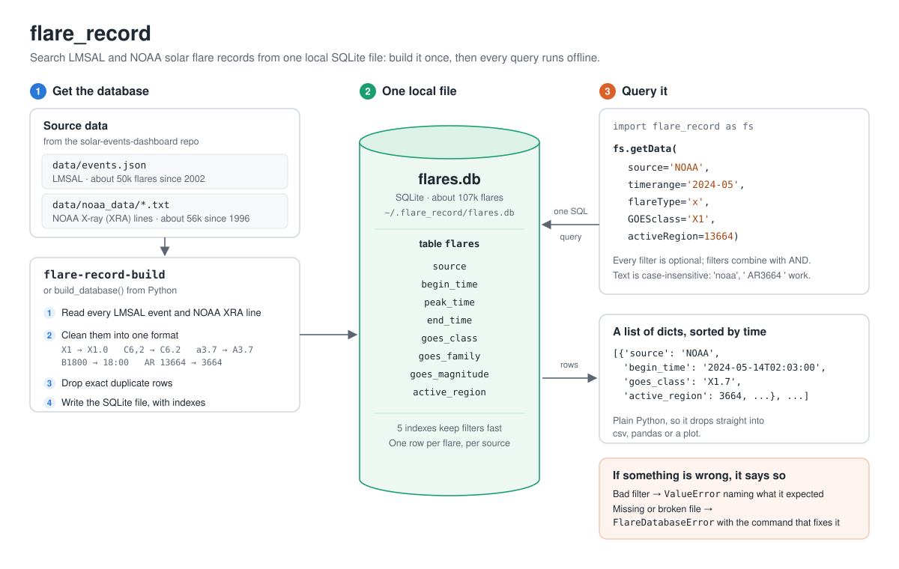

# flare_record

Search LMSAL, NOAA and NCEI solar flare records from one local database.



```python
import flare_record as fs

fs.getData(GOESclass='X1', timerange='20240514', source='NOAA')
```

```
[{'source': 'NOAA', 'begin_time': '2024-05-14T02:03:00', 'peak_time': '2024-05-14T02:09:00',
  'end_time': '2024-05-14T02:19:00', 'goes_class': 'X1.7', 'active_region': 3664},
 {'source': 'NOAA', 'begin_time': '2024-05-14T12:40:00', 'peak_time': '2024-05-14T12:55:00',
  'end_time': '2024-05-14T13:05:00', 'goes_class': 'X1.2', 'active_region': 3664}]
```

No network access is needed once the database is built. Every `getData()`
call reads a local SQLite file, so queries are fast: all 106,651 rows come
back in about 0.1 s, and a filtered query in a few milliseconds.

This package is separate from the
[`solar-events-dashboard`](https://github.com/thumybanh/solar-events-dashboard)
web API. Both read the same `events.json`, but neither depends on the other:
the API keeps working without this package, and this package works without
the API running.

## Contents

- [Quick start](#quick-start)
- [Trying it in the terminal](#trying-it-in-the-terminal)
- [Updating the data](#updating-the-data)
- [Query guide](#query-guide)
- [Recipes](#recipes)
- [Filters](#filters)
- [What you get back](#what-you-get-back)
- [API reference](#api-reference)
- [How it works](#how-it-works)
- [Notes on the data](#notes-on-the-data)
- [Configuration](#configuration)
- [Errors](#errors)
- [Tests](#tests)

## Quick start

Requires Python 3.9 or newer. The dependencies, `httpx` and `beautifulsoup4`,
install automatically (they're used only to download and update data).

**1. Install** (into any virtual environment):

```bash
pip install git+https://github.com/thumybanh/flare-record
```

For development, clone it and install editable instead:

```bash
git clone https://github.com/thumybanh/flare-record
pip install -e flare-record
```

**2. Build the database** (once, from the root of the
[`solar-events-dashboard`](https://github.com/thumybanh/solar-events-dashboard)
repo, which holds the source data; it reads `data/events.json` and
`data/noaa_data/`, and running it from any other folder fails with
`Can't find data/events.json` unless you set the paths, see
[Configuration](#configuration)):

```bash
flare-record-build
```

```
Loading LMSAL events from data/events.json...
  50371 events
Loading NOAA flares from data/noaa_data...
  56311 flares

Wrote 106651 rows to /Users/you/.flare_record/flares.db
```

Run it again whenever `data/events.json` or `data/noaa_data/` change. It replaces
the old database each time.

**3. Query it:**

```python
import flare_record as fs

results = fs.getData(source='NOAA', flareType='x')
print(len(results))            # 281
print(results[0]['goes_class'])  # X2.1
```

## Trying it in the terminal

Start Python with the virtual environment active (any folder works once
the database is built):

```bash
source venv/bin/activate    # the venv you installed into
python
```

Then at the `>>>` prompt:

```python
>>> import flare_record as fs
>>> r = fs.getData(GOESclass='X1', timerange='20240514')
>>> len(r)
4
>>> for x in r:
...     print(x['source'], x['begin_time'], x['goes_class'], x['active_region'])
...
LMSAL 2024-05-14T02:03:00 X1.7 3664
NOAA 2024-05-14T02:03:00 X1.7 3664
LMSAL 2024-05-14T12:40:00 X1.2 3664
NOAA 2024-05-14T12:40:00 X1.2 3664
>>> help(fs.getData)      # every option, in the terminal
>>> exit()
```

If the package code changes, quit Python and start it again; an open
session keeps using the old code.

| You see | Fix |
|---|---|
| `ModuleNotFoundError: No module named 'flare_record'` | Activate the venv you installed into |
| `Can't find data/events.json` from `flare-record-build` | `cd` to the `solar-events-dashboard` root first |
| `FlareDatabaseNotFoundError` or `FlareDatabaseInvalidError` | `cd` to the `solar-events-dashboard` root, run `flare-record-build` |

## Updating the data

The package is a snapshot, so a database built from it falls behind. To catch up
on your own, run this in a terminal:

```bash
flare-record-update
```

```
Updating LMSAL...
  17 LMSAL snapshots since 20261012
Updating NOAA...
Updating NCEI...
  downloading sci_xrsf-l2-flrpt_geo_s19950103_e20261027_v1-0-1.csv

LMSAL: +113 flares
NOAA: +89 flares
NCEI: +81957 flares
```

It continues from your database instead of starting over. Each source is asked
only for flares newer than the newest one you already have, so an update takes
seconds to a few minutes, however old your database is. Run it as often as you
like; a second run right after the first adds nothing.

| Source | What it downloads |
|---|---|
| LMSAL | The archive snapshots from a week before your newest LMSAL flare, adding flares you don't have. The week of overlap picks up entries LMSAL corrected after posting. |
| NOAA | NOAA's daily event reports from your newest flare's day to yesterday. The rows of those days are replaced. |
| NCEI | NCEI's current science-quality report (always one whole file). It is added as source `'NCEI'` and replaces the NCEI rows, unless it has fewer flares or lost region numbers, in which case it is refused. |

```bash
flare-record-update --source noaa          # one source
flare-record-update --source lmsal noaa    # or several
```

The same from Python:

```python
fs.update_database()                  # all three
fs.update_database('NOAA')            # one
fs.update_database(['LMSAL', 'NCEI'])
# {'LMSAL': {'added': 113}, 'NCEI': {'added': 81957}}
```

If one source can't be reached it is left exactly as it was, its error is
reported (`{'NCEI': {'error': '...'}}`, and the command exits with status 1),
and the other sources still update. A source that was interrupted partway
picks up where it stopped on the next update.

An update needs a database to continue from, so build or download one first.
Your database must already hold LMSAL and NOAA flares to update those sources.
LMSAL data you scrape yourself comes straight from the archive: it includes
the duplicate entries that the dashboard merges into one flare.

## Query guide

Copy any of these into Python after `import flare_record as fs`. Output is
from the real database (built September 2026), shortened with `...`.

### One filter

```python
# Every X-class flare NOAA has recorded
fs.getData(source='NOAA', flareType='x')         # 281 flares

# Everything from both sources on one day
fs.getData(timerange='20240514')                  # 17 flares

# Only LMSAL, or two sources named explicitly (leaving source out means every source in the database)
fs.getData(source='lmsal', timerange='20240514')  # 11 flares
fs.getData(source=['NOAA', 'LMSAL'], timerange='20240514')  # 17 flares

# Every flare in the database
fs.getData()                                      # 106,651 flares
```

### Dates: a year, a month, a day, a range, or a time window

```python
fs.getData(flareType='x', timerange='2024')       # 105 flares, all of 2024
fs.getData(flareType='x', timerange='2024-05')    # 41 flares, May 2024
fs.getData(timerange=('2024-05-10', '2024-05-11'))  # both days, inclusive

from datetime import datetime
fs.getData(timerange=(datetime(2024, 5, 14, 12), datetime(2024, 5, 14, 18)))
```

```
LMSAL  2024-05-14T12:40:00  X1.2  AR 3664
NOAA   2024-05-14T12:40:00  X1.2  AR 3664
LMSAL  2024-05-14T15:16:00  C9.7  AR 3664
NOAA   2024-05-14T15:16:00  C9.6  AR 3664
LMSAL  2024-05-14T16:46:00  X8.7  AR 3664
...    (8 flares)
```

### GOES class: a family, a bin, or an exact class

```python
fs.getData(GOESclass='X')                         # every X flare (same as flareType='x')
fs.getData(GOESclass='X1', timerange='202405')    # 26 flares: X1.0 through X1.9
fs.getData(GOESclass='X1.0', source='NOAA', timerange=('1996', '2002'))  # exactly X1.0
```

```
NOAA   1998-04-27T08:55:00  X1.0  AR 8210
NOAA   1998-08-24T21:50:00  X1.0  AR 8307
NOAA   1998-11-24T02:07:00  X1.0  AR None
NOAA   2000-06-18T01:52:00  X1.0  AR 9033
NOAA   2000-07-11T12:12:00  X1.0  AR 9077    <- NOAA wrote this one as "X1"
...    (8 flares)
```

### One active region, both sources side by side

```python
fs.getData(activeRegion=13664, flareType='x')     # 23 flares
```

```
LMSAL  2024-05-08T04:37:00  X1.0  AR 3664
NOAA   2024-05-08T04:37:00  X1.0  AR 3664
LMSAL  2024-05-08T21:08:00  X1.0  AR 3664
NOAA   2024-05-08T21:08:00  X1.0  AR 3664
NOAA   2024-05-08T21:08:00  X1.0  AR 3664
LMSAL  2024-05-09T08:45:00  X2.3  AR 3664
...
```

`13664`, `3664`, `'13664'` and `'AR3664'` all find the same region.

### Everything combined

```python
fs.getData(GOESclass='X1', source='NOAA', timerange='20240514', activeRegion='AR3664')
```

```
NOAA   2024-05-14T02:03:00  X1.7  AR 3664
NOAA   2024-05-14T12:40:00  X1.2  AR 3664
```

## Recipes

Results are plain Python lists of dicts, so ordinary Python is enough.
Each recipe below runs as written after `import flare_record as fs`.

### Count flares

```python
from collections import Counter

# By class family
may = fs.getData(timerange='202405', source='NOAA')
Counter(r['goes_class'][0] for r in may)
# {'C': 235, 'M': 122, 'X': 21}

# By source
Counter(r['source'] for r in fs.getData(flareType='x', timerange='2024'))
# {'LMSAL': 51, 'NOAA': 54}

# By year
x_flares = fs.getData(source='NOAA', flareType='x', timerange=('2020', '2025'))
sorted(Counter(r['begin_time'][:4] for r in x_flares).items())
# [('2021', 2), ('2022', 7), ('2023', 13), ('2024', 54), ('2025', 18)]
```

### Find the biggest flare

```python
# Within one family, the number after the letter is enough
max(fs.getData(flareType='x', source='NOAA'), key=lambda r: float(r['goes_class'][1:]))
# {'source': 'NOAA', 'begin_time': '2001-04-02T21:32:00', ..., 'goes_class': 'X20.0', 'active_region': 9393}

# Across families, rank the letter first (A < B < C < M < X)
def strength(r):
    return 'ABCMX'.index(r['goes_class'][0]), float(r['goes_class'][1:] or 0)

max(fs.getData(activeRegion=3664), key=strength)
# {'source': 'LMSAL', 'begin_time': '2024-05-14T16:46:00', ..., 'goes_class': 'X8.7', 'active_region': 3664}
```

### Combine several families

`flareType` takes one family per call, so combine calls and re-sort:

```python
m_and_x = fs.getData(timerange='202405', flareType='m') + fs.getData(timerange='202405', flareType='x')
m_and_x.sort(key=lambda r: r['begin_time'])
```

### Flare duration

```python
from datetime import datetime

def duration_minutes(r):
    if r['end_time'] is None:
        return None
    begin = datetime.fromisoformat(r['begin_time'])
    end = datetime.fromisoformat(r['end_time'])
    return (end - begin).total_seconds() / 60

flare = fs.getData(source='NOAA', GOESclass='X8.7', timerange='2024')[0]
duration_minutes(flare)    # 16.0
```

### Compare LMSAL and NOAA side by side

Group rows by begin time to see where the two catalogs agree:

```python
from collections import defaultdict

by_start = defaultdict(dict)
for r in fs.getData(flareType='x', timerange='202405'):
    by_start[r['begin_time']][r['source']] = r['goes_class']

for start, classes in by_start.items():
    print(start, classes)
```

```
2024-05-03T02:11:00 {'LMSAL': 'X1.7', 'NOAA': 'X1.6'}
2024-05-05T05:47:00 {'LMSAL': 'X1.3', 'NOAA': 'X1.3'}
2024-05-05T11:41:00 {'LMSAL': 'X1.3', 'NOAA': 'X1.2'}
2024-05-06T05:38:00 {'LMSAL': 'X4.5', 'NOAA': 'X4.5'}
...
```

```python
# Flares where the two catalogs give different classes
{start: c for start, c in by_start.items() if len(set(c.values())) > 1}
```

This pairs flares only when both sources give the *exact same* begin
time. The sources sometimes differ by a minute or more, so a flare that
shows up under one source only may still be in the other with a slightly
different time.

### Save to CSV

```python
import csv

results = fs.getData(flareType='x', timerange='2024')
with open('x_flares_2024.csv', 'w', newline='') as f:
    writer = csv.DictWriter(f, fieldnames=results[0].keys())
    writer.writeheader()
    writer.writerows(results)
```

```
source,begin_time,peak_time,end_time,goes_class,active_region
LMSAL,2024-02-09T12:53:00,2024-02-09T13:14:00,2024-02-09T13:31:00,X3.4,3575
NOAA,2024-02-09T12:53:00,2024-02-09T13:14:00,2024-02-09T13:32:00,X3.3,3575
...
```

### Use with pandas

pandas isn't required, but if you have it, any result becomes a table:

```python
import pandas as pd

df = pd.DataFrame(fs.getData(flareType='x', timerange='2024'))
df['begin_time'] = pd.to_datetime(df['begin_time'])
df.to_csv('x_flares_2024.csv', index=False)
```

## Filters

`getData(source=None, timerange=None, flareType=None, GOESclass=None, activeRegion=None)`

| Parameter | What it filters | Examples |
|---|---|---|
| `source` | Which catalog | `'NOAA'`, `'LMSAL'`, `'NCEI'` (after an [update](#updating-the-data)), `['NOAA', 'LMSAL']` (a list, tuple or set) |
| `timerange` | When the flare began | `'2024'`, `'202405'`, `'20240514'`, `'2024-05-14'`, `('20240501', '20240531')` |
| `flareType` | Class family | `'a'`, `'b'`, `'c'`, `'m'`, `'x'` (or uppercase) |
| `GOESclass` | Family, class bin, or exact class | `'X'`, `'X1'`, `'X1.0'`, `'C1.23'` |
| `activeRegion` | NOAA active region | `13664`, `'3664'`, `'AR13664'` |

- Every filter is optional. With none, you get every row in the database.
- Filters combine with AND: a flare must pass all of them.
- Text is case-insensitive and extra spaces are ignored (`' noaa '` works).
- Filters that can't both be true, like `flareType='m'` with
  `GOESclass='X1'`, return `[]`, not an error.
- Values that don't make sense raise `ValueError` (see [Errors](#errors)).

### `timerange`

| You pass | It means |
|---|---|
| `'2024'` | All of 2024 |
| `'202405'`, `'2024-05'` or `'2024/05'` | All of May 2024 |
| `'20240514'`, `'2024-05-14'` or `'2024/05/14'` | All of that day |
| `datetime.date(2024, 5, 14)` | All of that day |
| `datetime.datetime(2024, 5, 14, 12, 0)` | That exact minute |
| `(start, end)` using any of the above | From the start of `start` to the end of `end` |

So `('202405', '202406')` is May 1 00:00 through June 30 23:59:59, and
`(datetime(2024, 5, 14, 12), datetime(2024, 5, 14, 18))` is a six-hour
window. Timezone-aware datetimes are converted to UTC; plain ones are
treated as UTC.

**A flare matches if it _began_ inside the range.** A flare that began at
23:50 on May 13 and peaked on May 14 is not in `timerange='20240514'`.

Impossible dates (`'20240231'`), a start after the end, and anything that
isn't a date (`20240514` as an int, `'20240514 1200'`) raise `ValueError`.

### `GOESclass`

| You pass | It matches |
|---|---|
| `'X'` | The whole X family (same as `flareType='x'`) |
| `'X1'` | The X1 bin: X1.0, X1.1 … X1.9 |
| `'X10'` | X10.0 … X10.9 |
| `'X1.0'` | Exactly X1.0, including old NOAA records written `X1` |
| `'C1.2'` | C1.2, and two-decimal NOAA classes that round to it (`C1.17`, `C1.21`) |
| `'C1.23'` | Exactly C1.23 |

Classes are matched at the precision you type. `'X1,0'` (comma) works too.

### `activeRegion`

NOAA started reusing 4-digit region numbers in 2002, so region 13664 is
often written 3664. Both sources are stored as the 4-digit number, and the
filter accepts either: `13664`, `3664`, `'13664'`, `'AR3664'`, `'ar 13664'`.
Flares without a recorded region (`active_region` is `None`) never match.

## What you get back

A list of dicts, sorted by `begin_time`:

```python
{
    'source': 'LMSAL',                   # 'LMSAL' or 'NOAA'
    'begin_time': '2015-08-05T21:26:00',  # UTC
    'peak_time': '2015-08-05T21:29:00',   # UTC, or None
    'end_time': '2015-08-05T21:29:00',    # UTC, or None
    'goes_class': 'B7.1',                 # always 'X1.0' style, see below
    'active_region': 2396,                # 4-digit NOAA number, or None
}
```

Times are ISO strings, so they sort and compare correctly as text. Use
`datetime.fromisoformat(r['begin_time'])` to get a `datetime`. When a peak
or end time falls after midnight, it's already on the next day's date.

The same flare usually appears twice, once per source. The sources can
differ slightly on class or times (on 2024-05-10 at 06:27, NOAA says X3.9
and LMSAL says X4.0), so each row is kept as its source reported it.

## API reference

Everything below is available after `import flare_record as fs`.

| Name | What it does |
|---|---|
| `getData(...)` | Query the database. See [Filters](#filters). |
| `build_database(events_json_path, noaa_data_dir, output_path=None)` | Build the database from source files |
| `download_database(url, output_path=None)` | Download a pre-built database file |
| `update_database(sources=None, output_path=None)` | Bring the database up to date from the sources |
| `FlareDatabaseError` | Base class for database errors |
| `FlareDatabaseNotFoundError` | No database file at the path |
| `FlareDatabaseInvalidError` | File exists but can't be used |
| `__version__` | Package version, e.g. `'0.1.0'` |

Plus two terminal commands, `flare-record-build` and `flare-record-update`.

### `getData(source=None, timerange=None, flareType=None, GOESclass=None, activeRegion=None)`

Returns a list of dicts sorted by begin time (see
[What you get back](#what-you-get-back)). Every argument is optional; see
[Filters](#filters) for what each one accepts. Raises `ValueError` for an
unusable filter value and `FlareDatabaseError` if the database is missing
or broken.

### `build_database(events_json_path, noaa_data_dir, output_path=None)`

Python version of `flare-record-build`. Reads the LMSAL `events.json` and
the folder of NOAA `YYYYMMDDevents.txt` files, writes a fresh database, and
returns its path. Any database already at that path is deleted first.

```python
fs.build_database('data/events.json', 'data/noaa_data')
# PosixPath('/Users/you/.flare_record/flares.db')
```

`output_path` writes somewhere other than the default, which is handy for
keeping a second copy, e.g. a snapshot before the source data changes:

```python
fs.build_database('data/events.json', 'data/noaa_data', output_path='flares-2026-10.db')
```

To query a copy like that, see [Configuration](#configuration).

### `download_database(url, output_path=None)`

Downloads a pre-built `flares.db` file from `url` to the default database
location (or `output_path`) and returns its path, so you can skip the build
step and don't need the source data.

```python
fs.download_database('https://example.com/flares.db')
```

No pre-built database is hosted yet; until one is, use `flare-record-build`.
The download replaces any database already at that path. The file isn't
checked during download, but the next `getData()` call checks it and raises
`FlareDatabaseInvalidError` if the download was incomplete or wasn't a
database.

### `update_database(sources=None, output_path=None)`

Python version of `flare-record-update`; see
[Updating the data](#updating-the-data). `sources` is `'LMSAL'`, `'NOAA'`,
`'NCEI'` or a list of them (case doesn't matter); leave it out for all three.
Returns `{source: {'added': n}}`, or `{source: {'error': message}}` for a
source that failed, where `n` is the net change in that source's rows.
Raises `ValueError` for an unknown source and `FlareDatabaseError` if the
database is missing or broken.

### `flare-record-build`

Terminal command that calls `build_database()` with paths taken from
environment variables, or `data/events.json` and `data/noaa_data` in the
current folder. Takes no arguments. See [Configuration](#configuration).
If `FLARE_RECORD_NCEI_CSV` is set, or `data/goes_sciquality/` holds an NCEI
report, its flares are added too.

### `flare-record-update`

Terminal command that calls `update_database()`; `--source` limits it to the
sources named. See [Updating the data](#updating-the-data).

## How it works

```
data/events.json ─────┐
                      ├──> flare-record-build ──> ~/.flare_record/flares.db ──> getData(...) ──> list of dicts
data/noaa_data/*.txt ─┘    parse, clean, dedupe    SQLite, one table            filter with SQL
      (run once, and after the source data changes)         (every query)
```

**Build step** (`flare-record-build`, code in `flare_record/setup.py`):

1. Reads every LMSAL event from `data/events.json` and every `XRA` (X-ray
   flare) line from the `data/noaa_data/YYYYMMDDevents.txt` files. Other
   files in that folder are ignored.
2. Cleans each row:
   - Classes are rewritten in one format: `X1` becomes `X1.0`, `C6,2`
     becomes `C6.2`, `a3.7` becomes `A3.7`. Two-decimal classes keep both
     decimals (`C1.23`). The number is also stored separately so class
     bins can be searched as numbers.
   - NOAA times with a qualifier letter (`B1800` = began before 18:00,
     `A` = after, `U` = uncertain) keep the time and drop the letter.
   - Peak and end times earlier than the begin time are moved to the next day.
   - Region numbers are reduced to 4 digits.
   - Rows without a readable class or begin time are skipped.
3. Drops rows that are identical in every column (some NOAA files repeat
   a line).
4. Writes everything to a fresh SQLite file with one `flares` table and
   indexes on source, begin time, class, family and region.

**Query step** (`getData`, code in `flare_record/query.py`):

1. Checks each filter and turns it into a SQL condition, e.g.
   `GOESclass='X1'` becomes `goes_family = 'X' AND goes_magnitude >= 1 AND goes_magnitude < 2`.
2. Checks that the database file exists and has the right table and
   columns (`flare_record/db.py`).
3. Runs one query with all conditions joined by AND and returns the rows as
   dicts. Values are passed as SQL parameters, never pasted into the query.

**Files:**

```
flare-record/
├── pyproject.toml
├── README.md
├── flare_record/
│   ├── __init__.py          what `import flare_record` exposes
│   ├── query.py             getData() and filter checks
│   ├── setup.py             build_database(), download_database(), flare-record-build
│   ├── db.py                finds and validates the database file
│   └── exceptions.py        FlareDatabaseNotFoundError, FlareDatabaseInvalidError
└── tests/test_query.py
```

## Notes on the data

As of the September 2026 build:

| | LMSAL | NOAA |
|---|---|---|
| Rows | 50,371 | 56,280 |
| First flare | 2002-09-26 | 1996-07-31 |
| Last flare | 2026-09-24 | 2026-09-24 |
| Rows with no active region | about 11,000 | about 15,500 |

Things that can look surprising:

- **Old NOAA class formats.** NOAA reports from 1997–2002 sometimes write
  `X1`, `C1.23` or `C6,2`. They're stored as `X1.0`, `C1.23` and `C6.2`.
- **Three NOAA flares have no magnitude.** On 1999-12-21 NOAA recorded
  three flares as just `C`. Only `flareType='c'` or `GOESclass='C'` finds them.
- **Some classes are below 1**, like `C0.9` or `M0.9`, and one NOAA
  flare on 2019-08-18 is `A0.0`. That's what the source files say.
  `GOESclass='C'` includes `C0.9`; `GOESclass='C1'` does not.
- **Near-duplicate NOAA rows.** NOAA sometimes lists the same flare twice
  with different end times (e.g. AR 13664, X1.0 at 2024-05-08 21:08). Only
  rows identical in every column are removed, so both stay.
- **Lowercase LMSAL classes.** LMSAL wrote some 2006–2009 A-class flares
  in lowercase (`a3.7`). They're included as `A3.7`.

## Configuration

| Environment variable | Used by | Default |
|---|---|---|
| `FLARE_RECORD_DB` | `getData()`, `flare-record-build`, and `build_database()` / `download_database()` when no `output_path` is given | `~/.flare_record/flares.db` |
| `FLARE_RECORD_EVENTS_JSON` | `flare-record-build` | `data/events.json` under the current folder |
| `FLARE_RECORD_NOAA_DIR` | `flare-record-build` | `data/noaa_data` under the current folder |

To build from outside the repo root:

```bash
FLARE_RECORD_EVENTS_JSON=/path/to/events.json \
FLARE_RECORD_NOAA_DIR=/path/to/noaa_data \
flare-record-build
```

To keep the database somewhere else (`~` works):

```bash
export FLARE_RECORD_DB=~/data/flares.db
```

`getData()` reads `FLARE_RECORD_DB` on every call, so you can switch
databases from inside Python:

```python
import os

os.environ['FLARE_RECORD_DB'] = 'flares-2026-10.db'
len(fs.getData())               # rows in the snapshot
del os.environ['FLARE_RECORD_DB']
len(fs.getData())               # back to ~/.flare_record/flares.db
```

From Python, `fs.build_database('data/events.json', 'data/noaa_data')` does the
same as the command and returns the path it wrote (see
[API reference](#api-reference)).

## Errors

Database problems raise errors that include the fix:

```python
import flare_record as fs

try:
    results = fs.getData(source='NOAA')
except fs.FlareDatabaseNotFoundError:
    ...  # no database yet: run flare-record-build
except fs.FlareDatabaseInvalidError:
    ...  # database is a folder, empty, corrupted, or from an older version: rebuild it
```

Both inherit from `fs.FlareDatabaseError`, so you can catch that one to
handle any database problem.

| Problem | Message says |
|---|---|
| No file at the path | `No flare database found at ...` |
| Path is a folder | `it is a directory, not a database file` |
| Empty file | `the file is empty (0 bytes), possibly an interrupted build or download` |
| Not a SQLite file | `not a valid SQLite file` |
| SQLite file, but not a flare database | `missing the 'flares' table` |
| Built by an older version | `missing columns: [...]` — rebuild with `flare-record-build` |
| Table has no rows | `the flares table is empty` |

A value `getData()` can't use raises `ValueError` saying what it expected,
instead of quietly returning an empty list:

```
getData(timerange='2024-02-30')
    ValueError: timerange date '2024-02-30' is not a real date
getData(timerange=('20240515', '20240501'))
    ValueError: timerange start '20240515' is after end '20240501'
getData(GOESclass='Z9')
    ValueError: GOESclass must look like 'X', 'X1' or 'X1.5', got 'Z9'
getData(source='GOES')
    ValueError: source must be one of ['LMSAL', 'NOAA'] or a list of them, got 'GOES'
getData(activeRegion='abc')
    ValueError: activeRegion must be a region number like 13664 or 'AR3664', got 'abc'
getData(flareType='z')
    ValueError: flareType must be one of ['A', 'B', 'C', 'M', 'X'], got 'z'
getData(timerange=20240514)
    ValueError: timerange dates must look like '2024', '202405', '20240514' or '2024-05-14', or be a date/datetime, got 20240514
getData(timerange=('2024',))
    ValueError: timerange must be one date or a (start, end) pair, got 1 items: ('2024',)
```

## Tests

From the repo root:

```bash
pip install -e ".[test]"
pytest
```

```
105 passed in 0.29s
```

Most tests build a small throwaway database from made-up LMSAL and NOAA
files in the real formats, so they also test the build step. Three tests
check known flares in your real database and are skipped if
`~/.flare_record/flares.db` doesn't exist.
